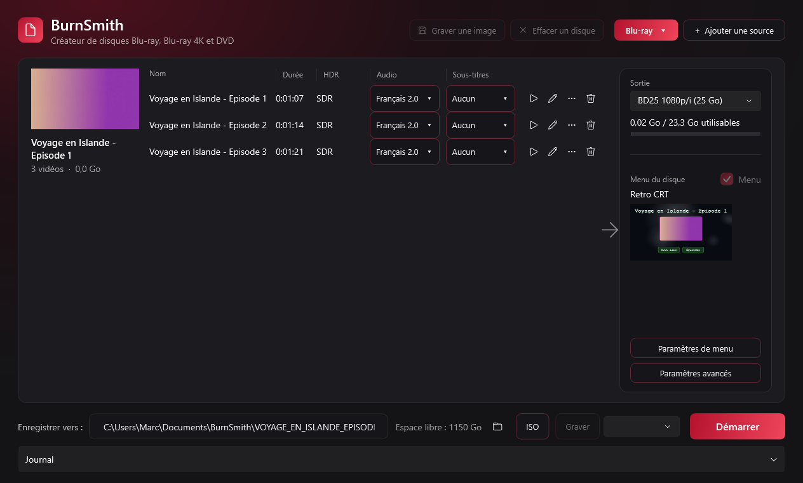
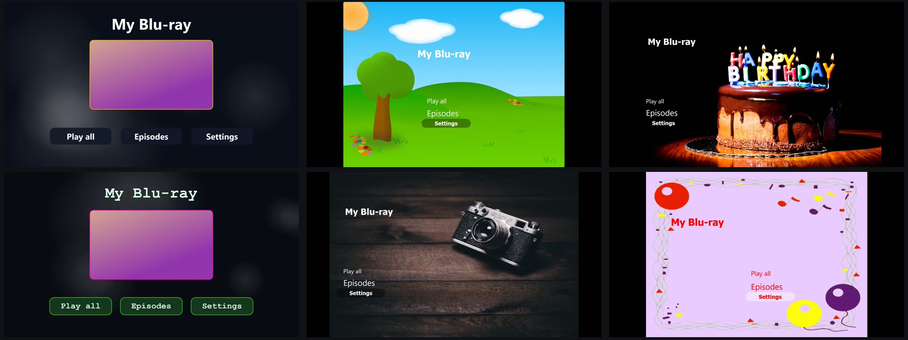
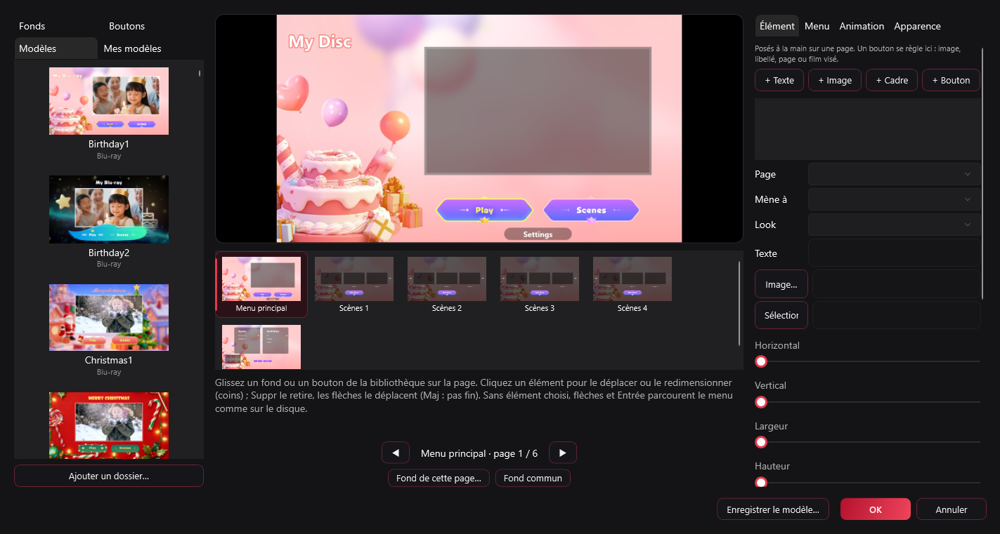

# BurnSmith

**Créateur de disques Blu-ray, Blu-ray 4K et DVD avec menus, pour Windows. Libre et gratuit.**

Glissez vos vidéos, choisissez un menu parmi **144 modèles** (ou dessinez le vôtre), cliquez sur *Démarrer* : vous obtenez un dossier de disque, une image ISO, ou le disque gravé.

> Projet jeune. Les dossiers BDMV générés se lisent dans VLC et les ISO se montent sous Windows ; la **gravure sur disque réel et la lecture sur lecteurs de salon n'ont pas encore été testées**.

## Pourquoi BurnSmith

### Ergonomique

Une seule fenêtre, en thème sombre : on dépose ses vidéos, et tout ce qu'il faut savoir est sur la ligne de chaque vidéo (durée, HDR, pistes audio et sous-titres) ; à droite, le format du disque, sa capacité restante et le menu choisi avec son aperçu. Un clic sur *Démarrer*, *ISO* ou *Graver*. Le crayon d'une vidéo ouvre sa coupe (début, fin, volume, chapitres), le « … » en fait un bonus, et ses listes Audio et Sous-titres règlent les pistes gardées et celles par défaut. Les sous-titres posés à côté de la vidéo (`film.fr.srt`…) sont proposés tout seuls.

Avant de graver, BurnSmith **contrôle le disque qu'il vient de construire** (fichiers, en-têtes, tailles, structure de l'image ISO) et refuse de graver s'il trouve une anomalie.

### Rapide, rien à installer en plus pour le Blu-ray

- **Un seul installateur** : tsMuxeR et les modèles sont dedans, et il trouve ffmpeg sur le PC ou le télécharge. Le Blu-ray ne demande rien d'autre ; le DVD demande deux outils en plus (voir *Démarrer*). Pas de logiciel de gravure à ajouter : l'ISO et la gravure passent par Windows (IMAPI2).
- **On ne réencode pas ce qu'on peut garder.** Une vidéo Blu-ray déjà conforme est recopiée telle quelle ; avec *Adapter au disque*, elle reste intacte tant qu'elle tient sur le disque et n'est refaite qu'au débit qui le remplit si elle est trop grosse. Le 4K n'est jamais réencodé.

### 144 modèles de menu

Des menus **prêts à l'emploi** pour un film, une série (page d'épisodes) ou un disque de bonus : 54 modèles libres et 90 modèles portés par l'exe publié, avec leurs pages de menu, de scènes et de réglages. L'exe publié les embarque tous ; le dépôt ne contient que les modèles libres. Un modèle déjà installé sur votre PC est lu sur place et remplace la copie portée.

Tous ces modèles se réunissent en **un seul format modifiable** avec « Convertir tous les modèles… » (éditeur, onglet *Modèles*) : un dossier par modèle dans `Documents\BurnSmith\Templates\converted`, avec un `template.json` lisible et les images PNG séparées par rôle — fonds, boutons (image normale et état sélectionné), cadres et vignette. La bibliothèque de l'éditeur reprend chaque fond et chaque bouton de ces packs, et un pack existant n'est jamais écrasé par une nouvelle conversion ([détails](docs/MODELES.md#un-seul-format--templatejson--images)).

### Des menus à votre image

L'éditeur dessine **en direct** les pages du disque (menu, scènes, réglages, crédits) et se parcourt comme sur le disque, à la souris ou aux flèches.

- **Composez** : fond (bibliothèque de fonds, ou vos images), police, style de boutons, grille des scènes, couleurs. Les onglets **Fonds** et **Boutons** se glissent sur la page.
- **Vignettes animées** : sur un DVD, chaque case de la page de scènes joue un court extrait de son chapitre au lieu d'une image fixe — la page reste immobile, seules les cases bougent. Pas avec un menu animé ni une musique de menu, et sans effet sur un Blu-ray. Case dans l'éditeur, `--animated-thumbs` en ligne de commande.
- **Surbrillances DVD prises aux modèles** : quand un modèle DVD fournit l'image de survol d'un bouton (`frame/0.dvd.sub.png` et son masque `frame/0.dvd.mask.png`), c'est elle qui devient la surbrillance du DVD, composée page par page et quantifiée en quatre couleurs ; l'état **choisi** a sa propre image, le marqueur du modèle (`selection/0.png`), à sa taille naturelle. Le cadre plat reste le repli pour les boutons sans artwork. `check-highlights --out DOSSIER` écrit les images de page, si un modèle DVD est présent.
- **Trois styles de surbrillance** pour le bouton choisi : cadre d'accent, soulignement, ou libellé en couleur (quand le modèle n'apporte pas sa propre image de survol), avec une **couleur de sélection distincte** de l'accent et sa **transparence** réglable (une couleur et une transparence propres). `--highlight` en ligne de commande.
- **Page de scènes en liste** : les chapitres ou les épisodes s'affichent en lignes de texte au lieu d'une grille de vignettes (le mode liste des thèmes) ; quand le modèle décrit cette liste (`ListTypeText` et ses dix `ItemText`), les lignes prennent ses positions, sa police et ses couleurs. `--list` en ligne de commande (aperçu **et** montage du disque).
- **Posez des éléments libres** : texte, image, cadre, ou **bouton** avec son action (« Mène à » : le film, un chapitre, une page). On les place à la souris sur l'aperçu et on les redimensionne par leurs coins ; ils sont fondus dans l'image du menu, donc identiques sur DVD et sur Blu-ray.
- **Enregistrez vos modèles** (« Mes modèles ») et réutilisez-les d'un disque à l'autre.
- Allez plus loin : **menu animé** (une vidéo en boucle derrière les boutons), **musique** du menu avec fondu, **page Crédits**, **page Bonus**, titre du disque par langue.

## Et aussi

DVD (PAL / NTSC), Blu-ray (1080p, 720p) et Blu-ray 4K · plusieurs vidéos et séries · pistes audio et sous-titres au choix, avec piste et sous-titre **par défaut** · sous-titres externes (`.srt`, `.ass`, `.vtt`, `.sup`, `.idx` + `.sub`) · chapitres automatiques ou à la main · capacité DVD-5/9 et BD-25/50/66/100 · effacement des disques réinscriptibles · [ligne de commande](docs/COMPILER-ET-LIGNE-DE-COMMANDE.md), à compiler soi-même (elle n'est pas dans la release). Le détail est dans les [fonctionnalités](docs/FONCTIONNALITES.md).

## Démarrer

Télécharger `BurnSmith-Setup-<version>.exe` dans [Releases](https://github.com/Balrog57/BurnSmith/releases) et le lancer. BurnSmith s'installe dans *Program Files* (Windows demande les droits administrateur), avec un raccourci dans le menu Démarrer et un désinstalleur. **Il faut Internet à l'installation si ffmpeg n'est pas déjà sur le PC** : l'installateur télécharge alors la dernière version publiée par gyan.dev (environ 115 Mo) ; sans connexion, BurnSmith s'installe quand même et dira ce qui manque quand on ajoute une vidéo. **Il se met à jour tout seul** : à chaque démarrage, une copie installée regarde si une release plus récente existe et propose de l'installer ; hors ligne ou déjà à jour, elle ne dit rien. Installation, mise à jour et désinstallation ont été essayées sur de vraies releases, jusqu'à la 0.5.4, sur un seul PC ; ces essais datent d'avant le téléchargement de ffmpeg, qui n'a pas encore tourné dans une vraie installation.

La **bibliothèque de modèles** est dans `Documents\BurnSmith\Templates` : un dossier visible, à sauvegarder ou à enrichir. Vos modèles et vos images n'y sont jamais effacés, même à la désinstallation ([détails](docs/MODELES.md#où-sont-les-modèles-sur-le-disque)).

Le mode **DVD** demande en plus `dvdauthor.exe` et `spumux.exe`, à indiquer par la variable d'environnement `BURNSMITH_TOOLS` ou le `PATH` ([détails](docs/COMPILER-ET-LIGNE-DE-COMMANDE.md)). Pour compiler vous-même : même document.

## Documentation

Tout est dans [`docs/`](docs/README.md) :

| | |
|---|---|
| [Fonctionnalités](docs/FONCTIONNALITES.md) | tout ce que fait BurnSmith, en détail |
| [Modèles de menu](docs/MODELES.md) | d'où viennent les modèles, la bibliothèque, l'état de chacun |
| [Installer, compiler, ligne de commande](docs/COMPILER-ET-LIGNE-DE-COMMANDE.md) | installateur et mise à jour automatique, compilation, commandes `bd` / `dvd` / `iso` / `burn` (à compiler), vérifications |
| [Plan de production](docs/PLAN-PRODUCTION.md) | où va le projet, dans quel ordre |

## Reste à faire

- **Essais de gravure sur disque réel et sur lecteurs de salon** (un DVD-RW d'abord, le Blu-ray en dernier) ; menus HDMV natifs, le menu BD-J actuel n'étant pas signé.
- Éditeur : annuler / rétablir. Aussi : amélioration IA / HDR, menu contextuel.

## Licence

MIT ([`LICENSE`](LICENSE)).

Les modèles livrés dans `assets/library/open` gardent leurs propres fichiers de licence ; les programmes que BurnSmith lance restent sous la leur. L'exe publié embarque aussi des images et des mises en page de modèles recueillis sur le PC de publication : elles appartiennent à leurs auteurs et ne sont pas dans le dépôt. Aucun code, interface, police ni programme n'est repris, et BurnSmith n'est affilié à aucun de leurs auteurs.
